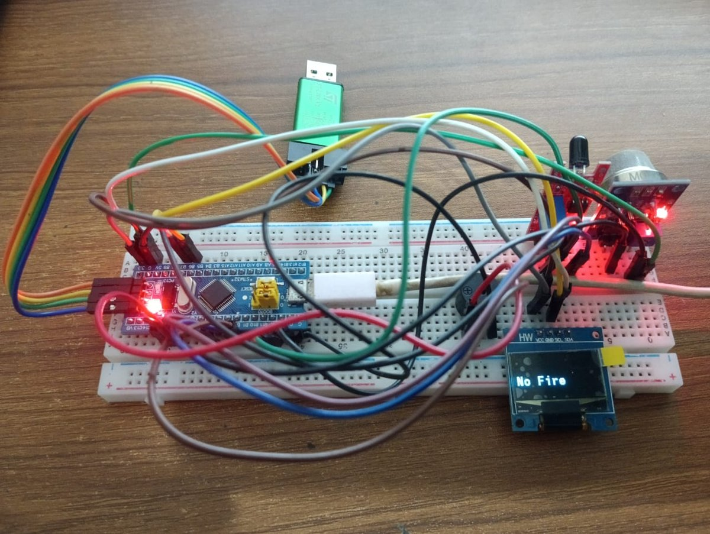

# Kitchen Leak Monitoring System (STM32)

A low-cost embedded system that watches a kitchen for **gas/smoke leaks and open flame** and raises a local alarm. An STM32 "Blue Pill" reads an MQ-2 gas/smoke sensor and a KY-026 flame sensor, shows the status on an OLED display, and drives a buzzer with a different pattern for each hazard.

CSE 331L (Microprocessor Interfacing & Embedded Systems Lab), North South University · Summer 2024
Moshiur Rahman · Shahariar Ifti · Pranjal Saha Arnob · Md. Mahedi Hasan
Faculty: Mohammad A. Qayum, Ph.D. · Lab instructor: Sheikh Mohammed Wali Ullah

<p align="center"></p>

## Why
Gas cylinders and line-gas stoves are the norm in Bangladeshi kitchens, and leaks and kitchen fires are a recurring cause of injury. Commercial detectors are often unaffordable. This prototype costs about **BDT 2,050 (≈ US$17)** in parts.

## How it works
| Hazard | Sensor | Pin | Detection | Alarm |
|---|---|---|---|---|
| Gas / smoke | MQ-2 (analog) | PA0 → ADC1 ch. 0 | ADC reading converted to volts (`adc × 3.3 / 4095`); alarm at ≥ 0.18 V | OLED shows **"Smoke"**, buzzer on PA1 beeps intermittently |
| Flame | KY-026 (digital out) | PA7 | Digital output goes active | OLED shows **"Fire"**, buzzer on PB0 sounds continuously |

The OLED (SSD1306, 128×64) is driven over I2C1 and shows the live sensor state. The firmware polls both sensors in the main loop.

## Hardware
| Component | Cost (BDT) |
|---|---|
| STM32F103C8T6 (Blue Pill) | 490 |
| MQ-2 gas/smoke sensor | 290 |
| KY-026 flame sensor | 80 |
| ST-Link V2 programmer | 550 |
| 0.96" SSD1306 OLED (I2C) | 420 |
| Buzzer | 20 |
| Jumper wires | 50 |
| Breadboard | 150 |
| **Total** | **2,050** |

## Repository structure
```
Core/Src/main.c     Application code: ADC, GPIO, I2C and OLED setup, sensing loop
figures/            Prototype photo
```
The project was generated with **STM32CubeMX** and built and flashed with **Keil µVision** via ST-Link. `main.c` depends on an SSD1306 driver (`ssd1306.h`, `fonts.h`) and the CubeMX-generated HAL files, which are not included here. To rebuild, create a CubeMX project for the STM32F103C8T6 with ADC1 (IN0), I2C1, and GPIO outputs on PA1/PB0 and input on PA7, add an SSD1306 HAL driver, and replace the generated `main.c`.

## Limitations and next steps
- The MQ-2 threshold is fixed and was tuned by hand (0.18 V in this code; 0.26 V in an earlier version in the report), so it can trigger on cooking smoke. Calibration against known gas concentrations would make it reliable.
- Alerts are local only. Adding Wi-Fi/GSM (e.g. ESP32 or SIM800L) would allow phone notifications when nobody is in the kitchen.
- The code also contains unused HC-SR04 ultrasonic definitions from an earlier idea.

## License
MIT. See `LICENSE`.
